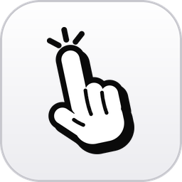
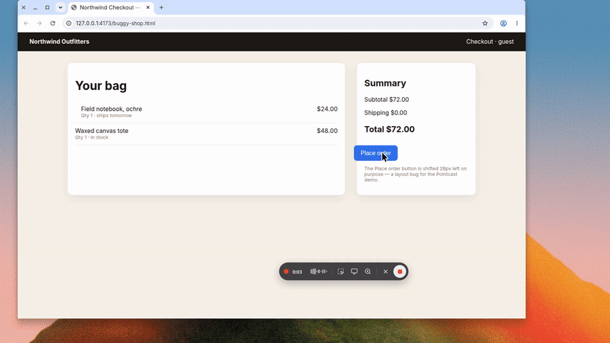

<p align="center"></p>

<h1 align="center">Pointcast</h1>

<p align="center"><b>Talk, point, paste.</b><br>Show an AI what you mean instead of describing it.</p>

<p align="center">
  
  
  <a href="LICENSE"></a>
  <a href="https://github.com/naidx0/pointcast/releases/latest"></a>
</p>

<p align="center">
  <a href="https://github.com/naidx0/pointcast/releases/latest/download/Pointcast-macOS.dmg"></a>
  &nbsp;
  <a href="https://github.com/naidx0/pointcast/releases/latest/download/Pointcast-Windows-setup.exe"></a>
</p>

<p align="center">or paste one line: see <a href="#install">Install</a></p>

<p align="center"></p>

Press one shortcut, say what you see, and point at or mark up the screen. When you stop, Pointcast
pastes one prompt, your words with the annotated screenshots where you took them, into the app you
were using: ChatGPT, Claude, Cursor, Claude Code, Codex, Slack or any text box.

It is a small native app for the macOS menu bar and the Windows tray. Speech is transcribed on your
computer. Nothing is uploaded.

## Install

The fastest way: copy one line, paste it, press Return. It downloads the latest version, checks it, installs it
and opens it. No warnings, no files to open.

**macOS 12+**: open Terminal (Spotlight: "Terminal") and paste:

```bash
curl -fsSL https://raw.githubusercontent.com/naidx0/pointcast/main/install.sh | bash
```

**Windows 10 or 11**: open PowerShell (Start: "PowerShell") and paste (no admin rights needed):

```powershell
irm https://raw.githubusercontent.com/naidx0/pointcast/main/install.ps1 | iex
```

Or use the **Download** buttons above (every version is on [Releases](https://github.com/naidx0/pointcast/releases/latest)).
Pointcast is not signed with a paid Apple or Microsoft certificate, so a downloaded installer gets a warning
the one-line install avoids: on macOS, drag Pointcast to Applications, then right-click it and choose **Open**
the first time (on macOS 15: **System Settings → Privacy & Security → Open Anyway**); on Windows, choose
**More info → Run anyway**.

A setup assistant then takes about a minute: allow access, pick a speech model, try the shortcuts and
make a practice recording. Pointcast opens at login from then on and updates itself from
**Settings → General**.

## How it works

1. **Start.** Press <kbd>⇧⌘Space</kbd> on macOS or <kbd>Ctrl+Shift+Space</kbd> on Windows. A small
   capsule shows the time and your voice level. It never takes focus from the app you are talking about.
2. **Talk and show.** Say what you see. Press <kbd>⌃⇧2</kbd> / <kbd>Ctrl+Shift+2</kbd> to mark up a
   region, <kbd>⌃⇧1</kbd> / <kbd>Ctrl+Shift+1</kbd> to capture the screen, or <kbd>⌃⇧Z</kbd> /
   <kbd>Ctrl+Shift+Z</kbd> for a close-up around the pointer.
3. **Stop.** Press the first shortcut again. One prompt is pasted where you were working and kept on
   the clipboard. On macOS pasting needs Accessibility; without it the prompt is copied for you to paste.

Any capture shortcut also starts a recording. Every shortcut can be changed in **Settings → Shortcuts**,
and you can hold the key while you talk instead of tapping it.

## Features

- **On-device speech.** Pick a model once; it downloads and then runs offline.

  | Model | Download | Best for |
  | --- | --- | --- |
  | Moonshine Base | 111 MB | Recommended. Fast and accurate English. |
  | Moonshine Tiny | 30 MB | The fastest, for short notes. |
  | Parakeet v2 | 482 MB | The most accurate English, with punctuation. |
  | Whisper Turbo | 574 MB | Any of 99 languages, detected automatically. Runs on your graphics card. |
  | Parakeet v3 | 487 MB | 25 European languages, detected automatically. |

  Whisper Turbo runs on your graphics card through [whisper.cpp](https://github.com/ggml-org/whisper.cpp):
  any Vulkan GPU on Windows and Linux, Metal on a Mac, with beam search for fewer wrong words than the
  processor build. On an RTX 2060 Super it transcribes a 10-second sentence in under a second. Without a
  usable graphics card it falls back to the processor, and Settings says which one it runs on. The
  574 MB model and a small helper program download with it; there is nothing else to install.

  The fast engine installs itself. If you use Whisper Turbo on the processor (from an earlier version, say),
  Pointcast downloads the graphics card version in the background while you are not recording, checks once
  that your graphics card runs it, and uses it from then on; the Whisper Turbo card in Settings › Speech
  shows how far it is, with a Cancel. A computer whose graphics card cannot run it keeps the processor
  version and is not asked again. To turn this off, switch off "Get the faster GPU version by itself" in
  Settings › Speech. Each prompt in History says how it was transcribed: "Transcribed on your graphics card
  (RTX 2060 SUPER) in 6 s · 20x real time" means Whisper ran on that card, at 20 times the speed of the
  recording; "on your processor" means it did not, and a graphics card would be much faster.

- **Mark-up tools.** The screen freezes; drag a box, then use pins with labels (P), arrows (A),
  rectangles (R), the highlighter (H), the pen (D), text (T) and a 2× magnifier (M). Five colors,
  undo and redo. **Return** captures, **Esc** steps back.
- **Pointing marks.** Rest the pointer on something for half a second and it gets a ring. The button,
  link or field under it is outlined and named in the prompt, like `button "Place order"`. Say "this"
  or "here" and the spot you pointed at in that moment is marked. Each is a switch in
  **Settings → Capture**.
- **History and Transcribe again.** The last 100 prompts are kept on this computer. Click a picture to
  mark it up again. **Transcribe again** writes a recording down afresh, for example after switching to
  a larger model.
- **Pastes anywhere.** Chat apps get the pictures inline; plain text with `[image n]` markers is the
  fallback. A recording with no pictures is plain dictation. You can also copy only, or save a
  `prompt.md` with PNGs (**Settings → Output**).
- **Pictures as file paths.** The prompt names each picture's file, so terminal agents such as Claude
  Code can open the screenshots.
- **Coding agents over MCP.** A local server lets Claude Code, Cursor and Codex fetch the latest prompt
  themselves. **Settings → Output → Agent setup** copies the setup for each one.
- **Native on each OS.** System Settings layout and system fonts on macOS; Mica, Segoe UI Variable and
  a Windows 11 Settings layout on Windows. Light and dark follow the system.
- **Private by default.** See below.

## Privacy

- Speech is transcribed on this computer. Nothing is uploaded.
- Audio of your newest 10 recordings is kept on this computer so you can transcribe it again, and is
  deleted with its History entry. Turn this off in **Settings → Speech**.
- The last 100 prompts, words and pictures, stay on this computer until you delete them in **History**.
- Pointcast's own windows are left out of every capture.
- Password managers (1Password, Bitwarden, KeePass, Dashlane, LastPass, Keeper, NordPass, Enpass,
  RoboForm, Proton Pass, Keychain Access, Credential Manager, Windows Security) are painted out before
  a picture is kept. Add your own apps in **Settings → Capture → Never capture**.
- The MCP server listens only on this computer, needs this computer's key and refuses web pages.
- Pointcast goes online only to download a speech model and, once a day, to ask GitHub whether a newer
  version is out. Turn that off in **Settings → General**.

## Troubleshooting

- **Nothing or little is written down.** Pointcast says when the microphone is silent or very quiet.
  Check that it is not muted, that the right one is picked in **Settings → Speech → Microphone**, and
  raise its input volume in the system's Sound settings.
- **Words go missing when you sit back or the room is noisy.** Keep **Settings → Speech → Pick up quieter
  and farther speech** on. Turn it off if it ever makes your voice sound wrong.
- **A shortcut does nothing.** Another app may own it. **Settings → Shortcuts** says which one is taken;
  click it and press new keys.
- **Transcription is slow.** Pointcast says when a model is slower than real time on your computer.
  Pick **Moonshine Base** in **Settings → Speech**.
- **Transcribing at the end takes long.** The capsule shows a progress bar; **Cancel** saves what is
  done and keeps the audio so you can **Transcribe again**.
- **macOS, after an update.** macOS asks again for Screen Recording and Accessibility. Turn them back on
  in **System Settings → Privacy & Security**, then reopen Pointcast.
- **Run the setup again.** Menu bar or tray icon → **Setup Assistant…**

Still stuck? [Open an issue](https://github.com/naidx0/pointcast/issues/new/choose).

## Uninstall

- **macOS:** turn off **Open at login** in Settings, quit Pointcast and drag it from Applications to the
  Trash. Its data is in `~/Library/Application Support/dev.pointcast.app`.
- **Windows:** Settings → Apps → Pointcast → Uninstall. Tick "Delete the application data" to remove
  models and history too.

## Build from source and contribute

See [CONTRIBUTING.md](CONTRIBUTING.md) for how the code is laid out, tests and releases, and
[docs/LOCAL_SETUP.md](docs/LOCAL_SETUP.md) for the prerequisites on each platform.

## Credits

Speech runs on [sherpa-onnx](https://github.com/k2-fsa/sherpa-onnx) (Apache-2.0). The models are
downloaded at setup, not bundled: [Moonshine](https://github.com/usefulsensors/moonshine) by Useful
Sensors (MIT), [Whisper](https://github.com/openai/whisper) by OpenAI (MIT) and
[Parakeet TDT](https://huggingface.co/nvidia/parakeet-tdt-0.6b-v2) by NVIDIA (CC-BY-4.0).

## License

[MIT](LICENSE).
