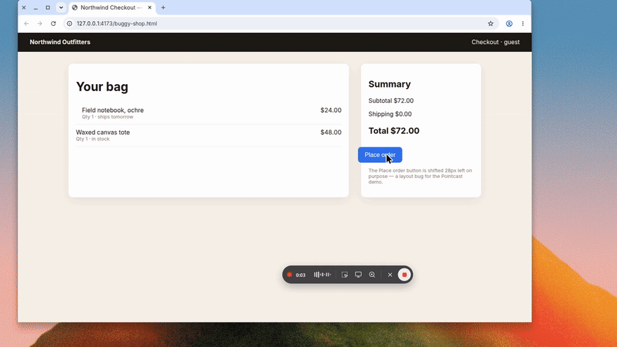

<p align="center"></p>

<h1 align="center">Pointcast</h1>

<p align="center"><b>Talk, point, paste.</b><br>Show an AI what you mean instead of describing it.</p>

<p align="center">
  
  
  <a href="LICENSE"></a>
  <a href="https://github.com/naidx0/pointcast/releases/latest"></a>
</p>

<p align="center">
  <a href="https://github.com/naidx0/pointcast/releases/latest/download/Pointcast-macOS.dmg"></a>
  &nbsp;
  <a href="https://github.com/naidx0/pointcast/releases/latest/download/Pointcast-Windows-setup.exe"></a>
</p>

<p align="center">or paste one line: see <a href="#install">Install</a></p>

<p align="center"></p>

Press one shortcut, say what you see, and point at or mark up the screen. When you stop, Pointcast
pastes one prompt, your words with the annotated screenshots where you took them, into the app you
were using: ChatGPT, Claude, Cursor, Claude Code, Codex, Slack or any text box.

It is a small native app for the macOS menu bar and the Windows tray. Speech is transcribed on your
computer. Nothing is uploaded.

## Install

The fastest way: copy one line, paste it, press Return. It downloads the latest version, checks it, installs it
and opens it. No warnings, no files to open.

**macOS 12+**: open Terminal (Spotlight: "Terminal") and paste:

```bash
curl -fsSL https://raw.githubusercontent.com/naidx0/pointcast/main/install.sh | bash
```

**Windows 10 or 11**: open PowerShell (Start: "PowerShell") and paste (no admin rights needed):

```powershell
irm https://raw.githubusercontent.com/naidx0/pointcast/main/install.ps1 | iex
```

Or use the **Download** buttons above (every version is on [Releases](https://github.com/naidx0/pointcast/releases/latest)).
Pointcast is not signed with a paid Apple or Microsoft certificate, so a downloaded installer gets a warning
the one-line install avoids: on macOS, drag Pointcast to Applications, then right-click it and choose **Open**
the first time (on macOS 15: **System Settings → Privacy & Security → Open Anyway**); on Windows, choose
**More info → Run anyway**.

A setup assistant then takes about a minute: allow access, try the shortcuts and make a practice
recording while the recommended speech model downloads. Pointcast opens at login from then
on and updates itself from **Settings → General**: **Check Now**, then **Update**. It closes, updates and opens
again by itself. On macOS an update keeps the access you gave: versions are signed with one certificate, so macOS
asks one last time on the update to the first version signed with it and not after
([how](docs/SIGNING.md)).

## How it works

1. **Start.** Press <kbd>⇧⌘Space</kbd> on macOS or <kbd>Ctrl+Shift+Space</kbd> on Windows. A small
   capsule shows the time and your voice level. It never takes focus from the app you are talking about.
2. **Talk and show.** Say what you see. Press <kbd>⌃⇧2</kbd> / <kbd>Ctrl+Shift+2</kbd> to mark up a
   region, <kbd>⌃⇧1</kbd> / <kbd>Ctrl+Shift+1</kbd> to capture the screen, or <kbd>⌃⇧Z</kbd> /
   <kbd>Ctrl+Shift+Z</kbd> for a close-up around the pointer.
3. **Stop.** Press the first shortcut again. One prompt is pasted where you were working and kept on
   the clipboard. On macOS pasting needs Accessibility; without it the prompt is copied for you to paste.

Any capture shortcut also starts a recording. Every shortcut can be changed in **Settings → Shortcuts**,
and you can hold the key while you talk instead of tapping it.

## Features

### Talk

- **On-device speech.** Pick a model once; it downloads and then runs offline.

  | Model | Download | Best for |
  | --- | --- | --- |
  | Moonshine Base | 111 MB | Recommended. Fast and accurate English. |
  | Moonshine Tiny | 30 MB | The fastest, for short notes. |
  | Parakeet v2 | 482 MB | The most accurate English, with punctuation. |
  | Whisper Turbo | 574 MB | Any of 99 languages, detected automatically. Runs on your graphics card. |
  | Parakeet v3 | 487 MB | 25 European languages, detected automatically. |

  Whisper Turbo runs on your graphics card through [whisper.cpp](https://github.com/ggml-org/whisper.cpp):
  any Vulkan GPU on Windows and Linux, Metal on a Mac. Without a usable graphics card it falls back to the
  processor, and Settings says which one it runs on. If you start on the processor version, Pointcast fetches the
  graphics card version in the background while you are not recording and checks once that your card runs
  it. Turn that off with "Get the faster GPU version by itself" in Settings › Speech.
- **The same audio gives the same words.** Transcribing a recording again gives the same text every time.
- **Every word after the press.** The microphone opens first, and the red dot shows as soon as audio is
  flowing. A microphone that is slow to start gets a "Getting ready…" line until it is.
- **Short replies are heard in context.** A short piece ("yes", "no, the other one") is decoded with the
  audio before it, so it is not guessed from a second of sound.
- **Tidy the text.** Paragraphs at your pauses, repeated words and a standalone "um" removed. Nothing is
  reworded or summarized. Turn it off in Settings › Output.
- **History and Transcribe again.** The last 100 prompts are kept on this computer. **Transcribe again**
  writes a recording down afresh, for example after switching to a larger model. Each prompt says how it
  was transcribed, such as "Transcribed on your graphics card (RTX 2060 SUPER) in 6 s · 20x real time".
  **Undo** brings back a deleted entry for 5 seconds.

### Point

- **Mark-up tools.** The screen freezes; drag a box, then pick a tool. Keys 1 to 5 pick the color.

  | Tool | Key | What it does |
  | --- | --- | --- |
  | Pin | P | A numbered dot with a label |
  | Step | S | A marker that counts up by itself: 1, 2, 3 |
  | Arrow | A | Points at something |
  | Rectangle | R | Outlines an area |
  | Highlighter | H | Marks over text |
  | Pen | D | Freehand |
  | Text | T | A note on the picture |
  | Magnify 2x | M | A 2x loupe on a detail |
  | Redact | X | Hides an area |

  **C** crops the picture after capture; marks stay where they are. **Return** captures, **Esc** steps
  back, **Cancel** leaves without capturing.
- **Pointing marks.** Rest the pointer on something for half a second and it gets a ring. The button,
  link or field under it is outlined and named in the prompt, like `button "Place order"`. Say "this"
  or "here" and the spot you pointed at in that moment is marked. Each is a switch in
  **Settings → Capture**.

### Paste

- **Short markers and one picture list.** The text carries `[image 1]`, `[image 2]` where you took the
  pictures. At the end, one list names each picture with its path, kind, size and marks, such as
  `[image 1] region 933x73 · pins: 1=too far left`. Switch the paths off in **Settings → Output**.
- **A folder an agent can open.** Each recording's pictures are saved as `~/Pointcast/<date_time>/01.png`,
  `02.png` and so on, in the order of the prompt, with a `prompt.md` and a `manifest.json`. Folders are
  deleted after 7 days or beyond the newest 30. Only folders Pointcast wrote are touched.
- **Copy from History is the same.** It uses the same markers, list and folder.
- **Pastes anywhere.** The prompt is plain text; the pictures are also on the clipboard as HTML, and apps
  differ in whether they take them. You can also copy only, or save a `prompt.md` with PNGs
  (**Settings → Output**).

### Lean

- **One small process when idle.** The speech engine is freed one minute after its last use, and the
  hidden capsule and overlay windows go after a minute. Loading the engine again happens while you talk.
  In **Settings › Speech**, choose 1, 5, 10 or 30 minutes, or Never.

### This computer

- **The microphone.** **Settings › Speech** shows the microphone in use with a live level, and says
  when it is silent, very quiet or slow to start. Each recording remembers which microphone it used, and
  History says if it was silent or slow.
- **The graphics card and speed.** A short block names your card, the engine in use and how fast it runs
  here, and says what to do if the card could help.

## Coding agents over MCP

With **Share over MCP** on, Pointcast runs an MCP server on this computer (`http://127.0.0.1:47821/mcp`,
streamable HTTP, protocol 2025-06-18). In **Settings › Output › Agents**, **Set up** adds a `pointcast`
entry with this computer's key to the agent's own user settings, changes nothing else in that file (the
first change keeps a `.pointcast-backup` copy), then checks that the server answers. **Remove** takes out
only that entry. Set up turns sharing on if it was off.

| Agent | File | Entry |
|---|---|---|
| Claude Code | `~/.claude.json` | `mcpServers.pointcast`: `type: "http"`, `url`, `headers.Authorization` |
| Cursor | `~/.cursor/mcp.json` | `mcpServers.pointcast`: `url`, `headers.Authorization` |
| Codex | `~/.codex/config.toml` | `[mcp_servers.pointcast]`: `url`, `http_headers = { Authorization = ... }` |

An agent that is not on this computer is never set up; **Copy command** or **Copy entry** gives you the
same entry to add by hand. Never put it in a project file: the key is this computer's. Five tool names:

| Tool | Arguments | Returns |
|---|---|---|
| `pointcast_latest` | `images?`, `copy_to?` | The last prompt with its pictures |
| `pointcast_get` | `id`, `images?`, `copy_to?` | A prompt from History |
| `pointcast_list` | `limit?` (10) | The newest prompts: id, when, length, first words, picture count |
| `pointcast_shot` | `id`, `n` | Picture `n` at full size |
| `get_latest_session` | | The older name for `pointcast_latest` |

Ask your agent "get my latest Pointcast prompt". The result is the prompt's text, then for each picture a caption such as
`[image 1] region 933x73 · pins: 1=too far left` followed by the picture as an image. Pictures are scaled
down to 1568 px on the long side, and a large one is sent as a JPEG (a PNG over 256 KB). One result holds
about 18,000 tokens and 1.5 MB of images; the rest come as file links, and `pointcast_shot` shows any one
of them. `images: "links"` gives only links, `"none"` only text.

`copy_to` takes your project's absolute path and copies the pictures and `prompt.md` into
`<project>/.pointcast/<time>/`, for agents that read only files inside the project. Pointcast writes
nothing else there. Add `.pointcast/` to your `.gitignore`.

Agents that limit file reads to the project can also be allowed to read `~/Pointcast`, where the
pictures are kept:

- Claude Code: `"permissions": { "additionalDirectories": ["~/Pointcast"] }` in `~/.claude/settings.json`
  (**Let Claude Code open the pictures folder** in Settings › Output adds it for you).
- Gemini CLI: `gemini --include-directories ~/Pointcast`.
- OpenCode: `"permission": { "external_directory": "allow" }` in `opencode.json`.

## Privacy

- Speech is transcribed on this computer. Nothing is uploaded.
- Audio of your newest 10 recordings is kept on this computer so you can transcribe it again, and is
  deleted with its History entry. Turn this off in **Settings → Speech**.
- The last 100 prompts, words and pictures, stay on this computer until you delete them in **History**.
- Pointcast's own windows are left out of every capture.
- Password managers (1Password, Bitwarden, KeePass, Dashlane, LastPass, Keeper, NordPass, Enpass,
  RoboForm, Proton Pass, Keychain Access, Credential Manager, Windows Security) are painted out before
  a picture is kept. Add your own apps in **Settings → Capture → Never capture**.
- Hidden areas (Redact) are replaced in the saved picture, and a recording with one carries no key frames.
  While you are marking up, the on-screen magnifier can still enlarge an area.
- The MCP server listens only on this computer, needs this computer's key and refuses web pages.
- Pointcast goes online only to download a speech model and, once a day, to ask GitHub whether a newer
  version is out. Turn that off in **Settings → General**.

## Troubleshooting

- **Nothing or little is written down.** Pointcast says when the microphone is silent or very quiet.
  Check that it is not muted, that the right one is picked in **Settings → Speech → Microphone**, and
  raise its input volume in the system's Sound settings.
- **Words go missing when you sit back or the room is noisy.** Keep **Settings → Speech → Pick up quieter
  and farther speech** on. Turn it off if it ever makes your voice sound wrong.
- **A shortcut does nothing.** Another app may own it. **Settings → Shortcuts** says which one is taken;
  click it and press new keys.
- **The first words are missing.** Wait for the red dot before you talk; a microphone that is slow to
  start shows "Getting ready…" until audio flows. **Settings › Speech** says when a microphone is slow to start (Bluetooth headsets
  are); a wired one starts at once.
- **No sound from this microphone.** Check it is not muted, or pick another one in **Settings › Speech**,
  which also shows its live level.
- **An agent cannot open the pictures.** Turn on **Let Claude Code open the pictures folder**
  (Settings › Output), or allow `~/Pointcast` in your agent (see above), or have it call
  `pointcast_latest` with `copy_to` set to your project.
- **Transcription is slow.** Pointcast says when a model is slower than real time on your computer.
  Pick **Moonshine Base** in **Settings → Speech**.
- **Transcribing at the end takes long.** The capsule shows a progress bar; **Cancel** saves what is
  done and keeps the audio so you can **Transcribe again**.
- **macOS, after an update.** Pointcast keeps Screen Recording and Accessibility from one version to the next.
  The one exception is the update to the first version signed with Pointcast's certificate (0.4.8), from an older
  one: macOS asks one last time. Turn them back on in **System Settings → Privacy & Security**, then reopen Pointcast.
- **macOS, updating from 0.4.7 or older: "The update did not finish".** The new version is installed, but the old
  Pointcast was never closed. Quit it from the menu bar and open Pointcast again. From 0.4.8 on, an update closes
  and reopens Pointcast by itself.
- **Checking for updates fails.** "Could not check: GitHub did not answer" means just that, not that you are up to
  date. Try again in a minute.
- **Run the setup again.** Menu bar or tray icon → **Setup Assistant…**

Still stuck? [Open an issue](https://github.com/naidx0/pointcast/issues/new/choose).

## Uninstall

- **macOS:** turn off **Open at login** in Settings, quit Pointcast and drag it from Applications to the
  Trash. Its data is in `~/Library/Application Support/dev.pointcast.app`.
- **Windows:** Settings → Apps → Pointcast → Uninstall. Tick "Delete the application data" to remove
  models and history too.

## Build from source and contribute

See [CONTRIBUTING.md](CONTRIBUTING.md) for how the code is laid out, tests and releases, and
[docs/LOCAL_SETUP.md](docs/LOCAL_SETUP.md) for the prerequisites on each platform.

## Credits

Speech runs on [sherpa-onnx](https://github.com/k2-fsa/sherpa-onnx) (Apache-2.0). The models are
downloaded at setup, not bundled: [Moonshine](https://github.com/usefulsensors/moonshine) by Useful
Sensors (MIT), [Whisper](https://github.com/openai/whisper) by OpenAI (MIT) and
[Parakeet TDT](https://huggingface.co/nvidia/parakeet-tdt-0.6b-v2) by NVIDIA (CC-BY-4.0).

## License

[MIT](LICENSE).
